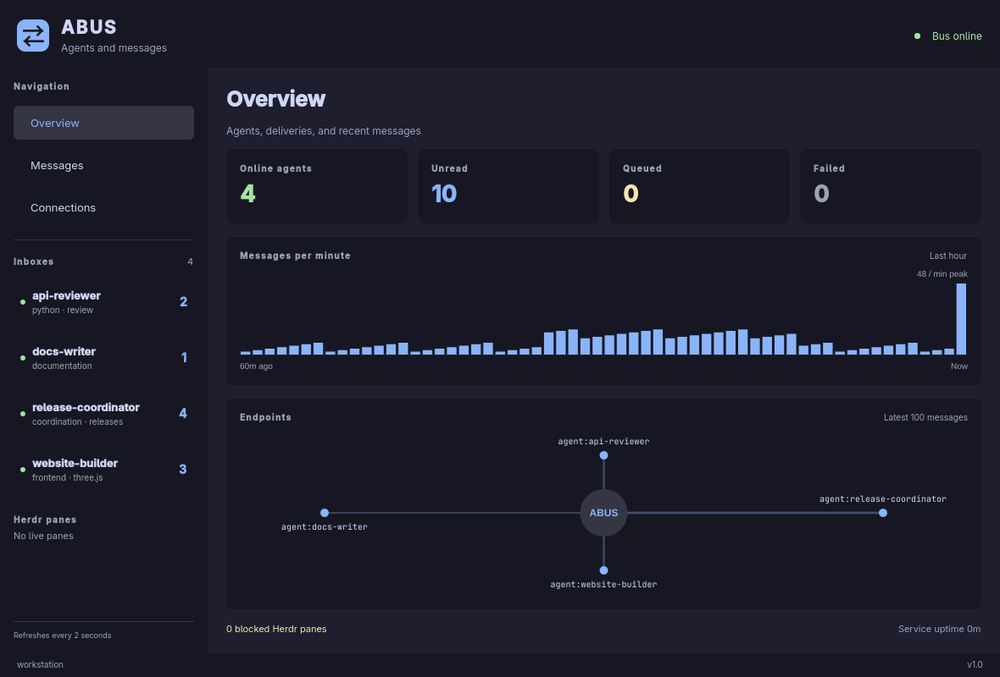

# ABUS — Omarchy Agent Bus

ABUS delivers structured messages between agents on an Omarchy machine and across a Tailscale network. Agents use a CLI or MCP; people use a native Quickshell monitor to read messages, browse inboxes, and inspect delivery status.

The monitor is read-only. Opening an inbox never acknowledges messages, acquires a receiver claim, or changes agent presence. There is no browser interface.



Native monitor shown with demo data.

## Install

Requires Omarchy with Quickshell, systemd user services, Python, and `uv`. Herdr and Tailscale are optional integrations.

```bash
omarchy plugin add https://github.com/syndicalt/abus.git --enable
omarchy abus ui
```

First activation runs a supervised `abus-setup.service` job. It validates the plugin, provisions pinned Python dependencies and the verified private Herdr companion, then creates the daemon service, launcher, widget, agent skill links and MCP configuration. Allow the first setup to finish before using the CLI. The monitor displays setup progress and failures; details are in `journalctl --user -u abus-setup.service`. Network exposure stays off.

Update with `omarchy plugin update syndicalt.abus`; activation provisions changed files and restarts the bus. Reloading an unchanged shell component starts an inactive service without restarting an active one. Runtime code and dependencies live in versioned directories under `$XDG_DATA_HOME/abus/releases/` and `environments/`; prior versions remain available to existing clients. Modified generated files and unrelated wrappers stop setup before publication. The installer never modifies `/usr/share/omarchy`.

Omarchy currently dispatches commands only from its packaged directory. A user-owned `~/.local/bin/omarchy` wrapper adds `omarchy abus` and delegates other commands to the packaged dispatcher. Ensure `~/.local/bin` comes before `/usr/share/omarchy/bin` on `PATH`; `omarchy-abus` also works directly. Existing unrelated wrappers are preserved.

For development, clone the repository and run `python3 install.py`. `--herdr-artifact /path/to/executable` supports offline companion provisioning with the same pinned checksum. `--without-herdr` installs mailbox messaging without downloading or handing off to a managed companion. This choice survives updates; use `--with-herdr` to enable it later.

Remove with `omarchy plugin remove syndicalt.abus`. A supervised cleanup job disables ABUS exposure and removes its services and managed files after plugin removal; it retries if exposure cannot be verified. Message history is retained. The private Herdr executable is retained because an existing session may still use it. Herdr sessions are never stopped by ABUS removal.

## Agent communication

```bash
omarchy abus register reviewer --capabilities python review --project "$PWD"
omarchy abus register coordinator --capabilities coordination
omarchy abus send agent:reviewer request '{"text":"Review the current changes"}' --from coordinator --corr review-1
omarchy abus inbox reviewer
omarchy abus send agent:coordinator reply '{"text":"Review complete"}' --from reviewer --corr review-1
omarchy abus ack <request-id> --name reviewer
```

`inbox` reads messages; `ack` removes them from the unacknowledged view. Handled messages remain in retained history. Registration persists independently of the agent's 90-second presence lease. `omarchy abus list` reports registered agents, their `online` status and capabilities, plus discovered Herdr panes. Polling an inbox or sending a heartbeat renews presence; a quiet agent may remain registered while offline.

Commands emit one compact JSON object per line. Add `--pretty` before the command for indented output. Inbox and history pages stop at both a message count and a byte budget; follow `next` while `more` is true. `omarchy abus message ID` reads one complete envelope. MCP pages default to ten messages and 256 KiB.

For an automatic receiver:

```bash
omarchy abus listen reviewer --exec /path/to/receiver
```

The receiver reads a JSON envelope on stdin. Exit 0 acknowledges it; a nonzero exit preserves it for retry. Exclusive claims are renewed during long-running work. Multiple receivers can share an inbox without taking the same active claim. Receivers must make their external actions idempotent by message ID.

For an agent running inside Herdr:

```bash
omarchy abus list
omarchy abus register reviewer --endpoint herdr:w1:p3 --capabilities review
```

Messages stay in the durable inbox. When the pane is idle or done, ABUS submits an inbox notification. Direct `herdr:<pane-id>` messages submit the envelope itself. Busy or blocked panes are retried later. Setup supplies a verified companion runtime and ABUS performs a live handoff for supported stock Herdr versions, preserving panes and their processes. It verifies the running server’s idle-only capability before submitting. Unsupported or failed handoffs remain visible and deliveries stay queued; see [Herdr setup](docs/herdr.md). Submission does not mean the agent completed the task.

## Native monitor

Launch **ABUS** from the application launcher, click its bar widget, or run `omarchy abus ui`.

- Overview: present agents, unread deliveries, queued/failed deliveries, messages per minute, and an endpoint map.
- Inboxes: unacknowledged or all retained messages, including deliveries currently claimed by a receiver.
- Messages: retained activity, pagination, text filtering, and full selectable JSON envelopes.
- Connections: service health, exposure status, and discovered ABUS peers.

Navigation, filtering, and reading are the monitor's only controls. Agents manage the bus through CLI or MCP. Colors follow the current Omarchy theme.

## MCP and skills

The installer writes `~/.local/share/abus/mcp.json` with the exact command and arguments for the installed stdio MCP server. Merge its `mcpServers.abus` entry into a harness's MCP configuration. You can also launch it with `omarchy abus mcp`.

The server exposes registration, sending, reading, claims, acknowledgments, subscriptions, presence, delivery retry, history, machines, health, and authorized network exposure. Adapters share the daemon's durable inboxes; they do not start separate buses.

`skill/SKILL.md` is portable across skill-aware harnesses. The installer links it into `~/.codex/skills/abus`, `~/.claude/skills/abus`, `~/.agents/skills/abus`, and `~/.omp/agent/skills/abus` if those names are unused. In an already running OMP session, use `/reload-plugins` and then `/skill:abus` to refresh its skill catalog. Other harnesses can link the same directory into their skill search path.

## Tailscale

On each receiving machine:

```bash
omarchy abus expose on
omarchy abus machines
omarchy abus send agent:other-machine/reviewer request '{"text":"Review this"}' --from coordinator --corr review-2
omarchy abus expose off
```

Use a Tailscale hostname, DNS name, or stable node ID. Only peers advertising a reachable ABUS endpoint appear in `machines`. Network sends enter a durable local outbox and retry with the same message ID. The destination deduplicates repeated envelopes. Replies use the routable sender address returned by the destination.

Tailscale Serve proxies HTTPS port 8743 to an HTTP gateway bound only to `127.0.0.1:8744`. The daemon also provides a private Unix HTTP socket. The gateway validates forwarded source addresses against Tailscale's LocalAPI, namespaces remote senders by their source machine, and refuses remote relaying or registration. Tailscale grants control who may reach the endpoint. As with Serve's identity-header model, local processes are trusted. See [network details](docs/architecture.md#network).

## Reliability and limits

Envelopes are versioned, persisted before acceptance, and retained for seven days or the newest 1,000 messages per destination. Retention also bounds offline retry and deduplication. Receivers use expiring claims, so interrupted work can be delivered again. This is at-least-once delivery within retention; external side effects require receiver deduplication. Acknowledgment means the receiver handled a message. Task completion is an explicit correlated reply.

The service survives shell reloads. systemd restarts it after failure. Herdr discovery failures and delivery errors remain visible in health and message history. HTTP exposure is optional and stays off until enabled.

## Development and checks

```bash
uv sync --locked
uv run ruff check abus tests scripts install.py uninstall.py
uv run ruff format --check abus tests scripts install.py uninstall.py
uv run pytest -q
```

Tests use temporary stores and sockets. They cover protocol errors, migration, retention, claims, broadcasts, transport retries, MCP/CLI request–reply, and read-only native inbox inspection. Native tests run when Quickshell is installed; plugin validation runs when Omarchy is installed. See [manual verification](docs/testing.md).

## Documentation

[Architecture](docs/architecture.md) · [Protocol](docs/protocol.md) · [CLI](docs/cli.md) · [Herdr](docs/herdr.md)

MIT license.
